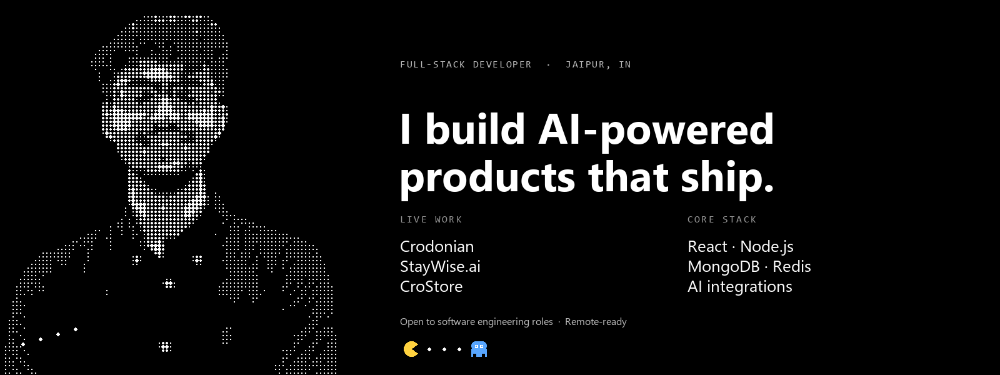
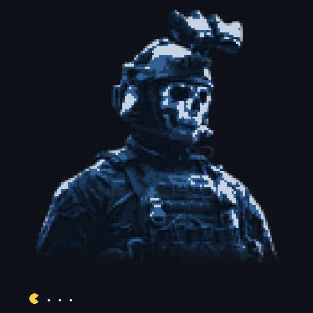

  

<h1 align="center">Hi, I'm Anmol</h1>

<h3 align="center">Full-Stack Developer</h3>

  

Building reliable full-stack products with clean architecture, AI integrations, and interfaces that feel effortless.

<h2 align="center">About Me</h2>

**Anmol**, here — a Computer Science student at JECRC University in Jaipur, currently maintaining a 9.12 CGPA.

I build full-stack products with React, Node.js, MongoDB, and Redis, and I care about how they feel as much as how they work.

My recent work includes building Crodonian, a digital product studio, and StayWise.ai, an AI hotel booking and management platform.

I'm going deeper into backend architecture, system design, and AI integrations. I'm open to software engineering internships, entry-level roles, and remote collaborations.

 

<h2 align="center">Connect</h2>

  
  &nbsp;&nbsp;&nbsp;
  
  &nbsp;&nbsp;&nbsp;
  

  <a href="https://builtbyanmol.dev">Portfolio</a> ·
  <a href="https://res.cloudinary.com/anmol-portfolio/image/upload/v1787214068/portfolio/resumes/Anmol_Singh_Resume.pdf">Resume</a> ·
  <a href="https://x.com/anmol_creates">X</a>

<h2 align="center">Tech Stack</h2>

  

  
  &nbsp;&nbsp;
  
  &nbsp;&nbsp;
  
  &nbsp;&nbsp;
  
  &nbsp;&nbsp;
  

<h2 align="center">GitHub Stats</h2>

  

<h2 align="center">Activity Graph</h2>

  

<h2 align="center">Commit Activity</h2>

  <picture>
    <source media="(prefers-color-scheme: dark)" srcset="https://raw.githubusercontent.com/anmol-devs/anmol-devs/output/pacman-contribution-graph-dark.svg">
    <source media="(prefers-color-scheme: light)" srcset="https://raw.githubusercontent.com/anmol-devs/anmol-devs/output/pacman-contribution-graph.svg">
    
  </picture>

<h2 align="center">Philosophy</h2>

  

